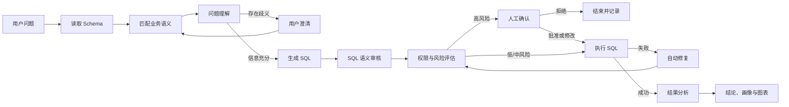

# DataPilot：Text-to-SQL 智能数据分析 Agent

DataPilot 是一个面向业务人员的 Text-to-SQL 数据分析 Agent。用户输入中文问题后，系统能够完成
业务语义理解、SQL 生成与审核、安全执行、失败修复、结果解读和图表展示。

项目重点不是“调用一次大模型生成 SQL”，而是构建一条可恢复、可审核、可评测、可部署的
Agent 工作流。

## 解决的问题

- **业务口径不统一**：语义层统一销售额、销量、支付率、客单价等指标定义。
- **复杂问题容易误解**：生成 SQL 前识别歧义，必要时通过多轮对话澄清。
- **模型输出不可直接信任**：SQL Reviewer 检查指标、过滤、关联和聚合逻辑。
- **数据库执行存在风险**：SQLGlot AST 实现只读校验、表字段权限、行数与超时限制。
- **复杂查询需要人工介入**：风险分级后暂停工作流，支持批准、修改或拒绝 SQL。
- **执行失败体验差**：结合错误信息、Schema 和语义上下文自动修复并再次校验。
- **结果难以理解**：自动生成中文结论、数据画像及指标卡、柱状图和折线图。

## Agent 工作流



LangGraph 使用 `request_id` 作为线程标识，将中断状态写入 SQLite checkpoint。即使服务重启，
等待澄清或等待审批的任务仍可继续执行。

## 核心能力

### Schema 自动感知与业务语义层

系统通过 SQLAlchemy 自动读取表、字段、类型、主键和外键。结构化语义目录进一步为指标和维度
定义别名、计算公式、必需表、默认过滤、时间字段和业务备注。

当前覆盖销售额、销量、订单数、支付率、取消率、客单价等 10 个指标，以及地区、分类、商品、
客户、状态、日期、月份和年份等 8 个维度。

### 可靠的 SQL 处理链路

- 兼容 OpenAI API 协议的模型客户端，支持超时、重试和结构化响应。
- SQL Reviewer 在执行前检查问题、Schema、业务语义和 SQL 是否一致。
- SQLGlot AST 校验只允许查询语句，并限制表、字段、最大行数和执行时间。
- 执行错误触发受控修复，修复后的 SQL 必须重新通过权限和风险检查。

### Human-in-the-loop 与 Checkpoint

复杂 JOIN、CTE、窗口函数和递归查询会进入风险评估。高风险查询暂停在人工确认节点，用户可以
批准、修改或拒绝；人工修改的 SQL 不会绕过安全策略。澄清和审批状态通过 checkpoint 持久化。

### 结果分析与可视化

查询成功后，由程序确定性计算数值字段的最小值、最大值、合计和平均值，再由模型生成中文总结和
关键洞察。React 工作台使用 ECharts 展示指标卡、柱状图、折线图、饼图和明细表。模型分析失败时，
原始数据和图表推荐仍然正常返回。

### 评测、审计与可观测性

- 每个请求生成唯一 `request_id`，记录问题、SQL、状态、错误和耗时。
- 50 条 Golden SQL 数据集支持离线校验和真实模型批量回归。
- API 返回 Schema、LLM、SQL、其他处理和总耗时。
- 56 个自动化测试覆盖核心业务节点。

## 技术栈

| 层次 | 技术 |
| --- | --- |
| Agent 编排 | LangGraph、Checkpoint、Interrupt/Resume |
| 模型接入 | OpenAI-compatible API、HTTPX |
| 后端 | Python 3.12、FastAPI、Pydantic、SQLAlchemy |
| SQL 安全 | SQLGlot AST、只读策略、表字段权限、风险分级 |
| 数据库 | SQLite（业务库、审计库、Checkpoint） |
| 前端 | React 19、Vite、Ant Design、ECharts |
| 质量保障 | Pytest、Ruff、Oxlint、50 条 Benchmark |
| 部署 | Docker、Docker Compose、Nginx |

## 项目结构

```text
Text-t-SQL/
├── app/
│   ├── agent/          # LangGraph 状态、节点、路由与运行时
│   ├── api/            # 查询、澄清、确认、审计及 Schema API
│   ├── audit/          # 查询审计
│   ├── db/             # ORM、Schema 读取和演示数据
│   ├── evaluation/     # 50 条问题自动化评测
│   ├── knowledge/      # 业务规则与语义目录
│   ├── llm/            # 模型客户端与 Prompt
│   └── services/       # SQL、权限、风险、语义及结果分析
├── frontend/           # React 数据分析工作台
├── benchmarks/         # 标准问题集与评测报告
├── tests/              # 自动化测试
├── docs/               # 简历文案与演示材料
├── Dockerfile          # FastAPI 后端镜像
└── compose.yaml        # 前后端与持久化卷编排
```

## 快速体验

### Docker Compose 一键启动

将 `.env.example` 复制为 `.env` 并配置模型服务：

```env
AGENT_RUNTIME=langgraph
LLM_BASE_URL=https://api.openai.com/v1
LLM_API_KEY=your-api-key
LLM_MODEL=gpt-4o-mini
```

```powershell
docker compose up -d --build
```

- 数据分析工作台：http://localhost:8080
- API 文档：http://localhost:8000/docs
- 健康检查：http://localhost:8000/health

Windows 用户也可以双击 `start.bat` 启动，双击 `stop.bat` 停止。SQLite 业务数据、审计记录和
checkpoint 保存在 `datapilot-data` 数据卷中。

### 本地开发

```powershell
conda activate text2sql-agent
python -m pip install -e ".[dev]"
datapilot-seed
python -m uvicorn app.main:app --reload
```

在另一个终端启动前端：

```powershell
cd frontend
npm.cmd install
npm.cmd run dev
```

访问 http://localhost:5173。

## 推荐演示问题

```text
一共有多少订单？
按订单状态统计订单数量。
按月份统计订单数量，月份字段命名为 order_month。
各地区已支付订单的销售额是多少？
销量最好的产品是什么？
按地区和商品分类统计销售额，并计算地区内排名。
```

这些问题分别演示指标卡、柱状图、折线图、语义口径、多轮澄清和人工确认。

## API

| 方法 | 路径 | 作用 |
| --- | --- | --- |
| GET | `/health` | 服务健康检查 |
| GET | `/api/v1/schema` | 查看数据库结构 |
| POST | `/api/v1/query` | 发起自然语言查询 |
| POST | `/api/v1/query/{request_id}/clarify` | 补充信息并恢复工作流 |
| POST | `/api/v1/query/{request_id}/confirm` | 批准、修改或拒绝 SQL |
| GET | `/api/v1/audit/{request_id}` | 查询审计记录 |

## 测试与评测

```powershell
python -m pytest -q
python -m ruff check .
datapilot-benchmark --gold-only
datapilot-benchmark
```

评测会执行生成 SQL，并将查询结果与标准 SQL 的结果进行标准化严格比对，而不是只比较 SQL 字符串，
因此允许不同但结果等价的写法。详细报告位于 `benchmarks/`。
